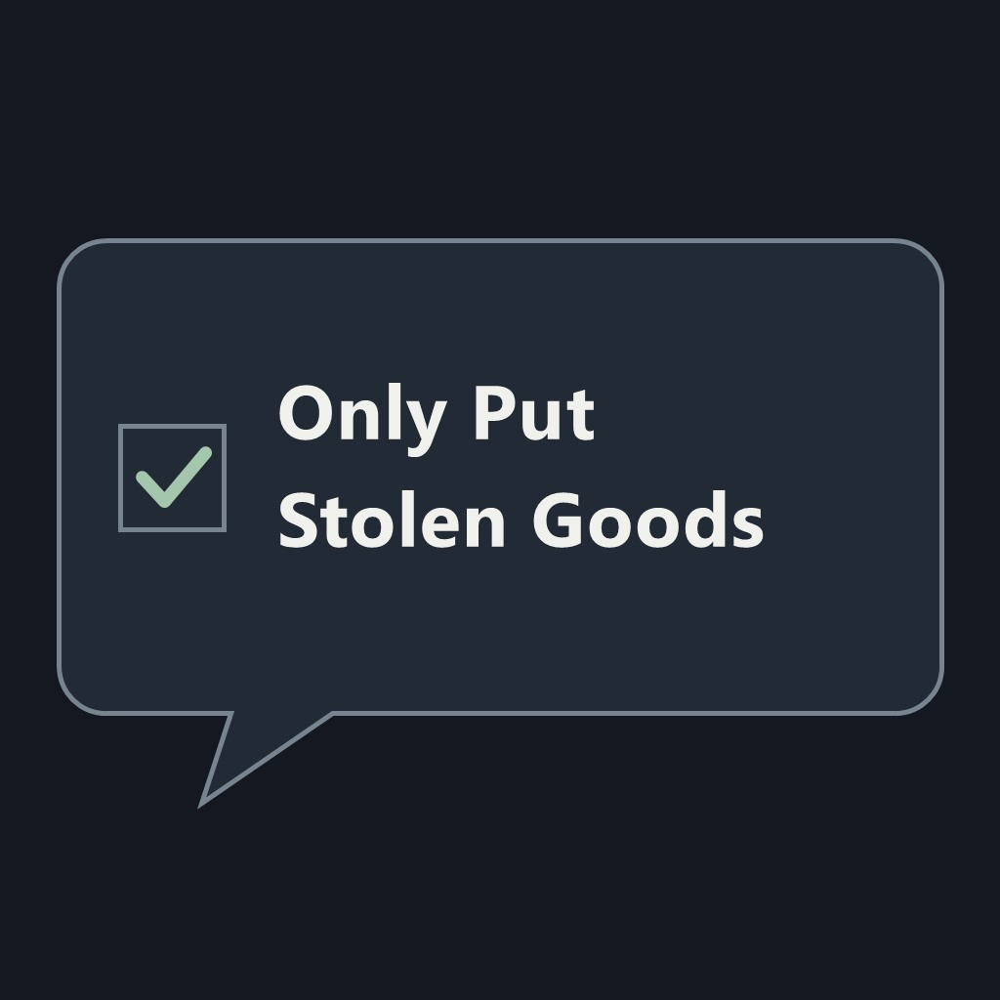
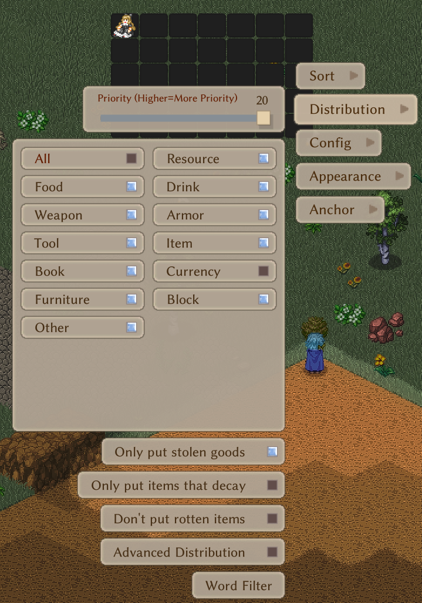
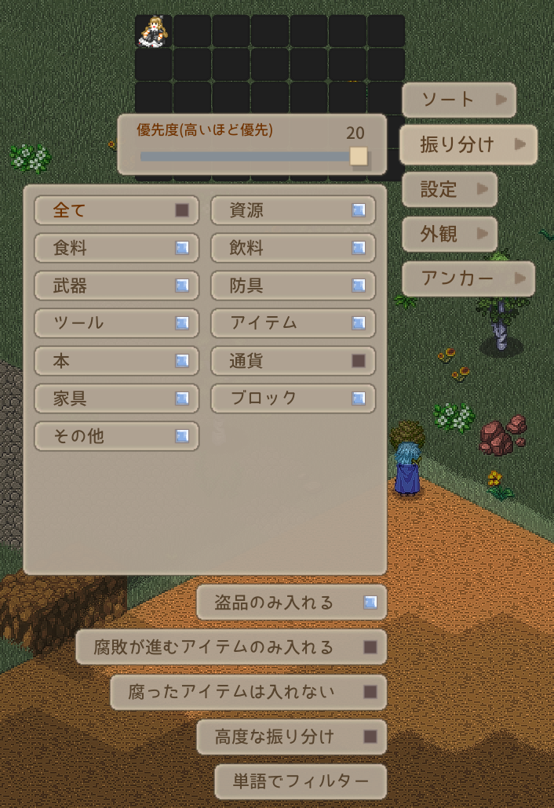
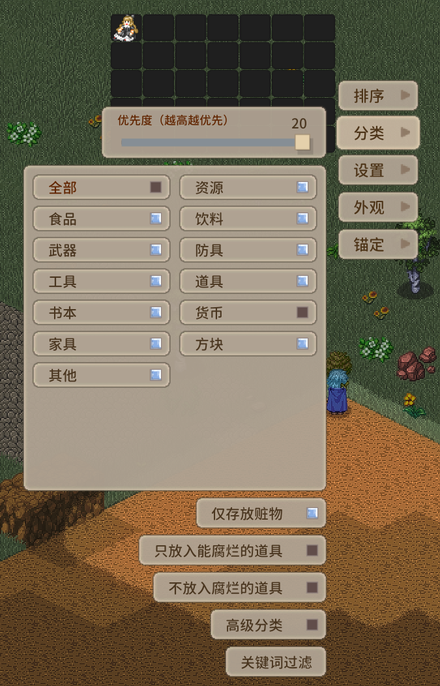

# Stolen Goods Filter

An Elin game mod for adding a container configuration toggle for only accepting stolen items.

## Install and use

**[Install on Steam Workshop](https://steamcommunity.com/sharedfiles/filedetails/?id=3836640580)**

Subscribe on the Workshop page to install through Steam, then enable the mod in Elin.



Open a container's distribution settings and enable **Only put stolen goods**.
The option appears below either the normal or advanced filter list. It defaults
to off. The toggle reads **盗品のみ入れる** in Japanese, **仅存放赃物** in
Simplified Chinese, and **Only put stolen goods** in English or other languages.
Enabled containers accept only items with the game's stolen status;
existing category filters, word filters, and priorities still apply. Give your
stolen-goods container a higher priority to route eligible items there first.
Manual transfers and automatic pickup settings are unchanged.

Standalone: no other Workshop mods, development bridge, or companion application
are required. Tested with Elin **23.355**, plugin version **1.0.1**.

### Distribution settings

| English | 日本語 | 简体中文 |
| --- | --- | --- |
|  |  |  |

See [CHANGELOG.md](CHANGELOG.md) for release notes in English and Japanese.

## Build and manual installation

Requirements: Windows, a .NET SDK and the .NET Framework 4.8 targeting pack, and
your installed copy of Elin with its BepInEx assemblies. Game and dependency DLLs
are referenced locally and are not included in this repository.

In PowerShell, set your actual game path and build:

```powershell
$env:ELIN_DIR = 'D:/SteamLibrary/steamapps/common/Elin'
dotnet build StolenGoodsFilter.csproj -c Release -p:Platform=AnyCPU
python install.py
```

Alternatively, pass `-p:ElinDir=YOUR_GAME_PATH` to the build and
`--game-dir YOUR_GAME_PATH` to the installer. Python 3 is needed only for the
optional installer and packaging tests.

The installer copies the DLL, `package.xml`, and `preview.jpg` into
`Package/StolenGoodsFilter`, backs up replaced files locally, and verifies hashes.
It does not restart or save the game. Restart Elin normally to load the mod.
You may also copy those three files into that folder manually.

Release/debug builds omit debug symbols and map source paths to avoid embedding
personal filesystem paths. The project never deploys as a side effect of building.

## Tests

```powershell
dotnet build tests/Controls.csproj -c Release -p:Platform=AnyCPU
./tests/bin/Release/net48/Controls.exe
python -m unittest discover -s tests -p test_package.py -v
```

The 18 C# controls cover localized labels, filter behavior, vanilla-rule composition, persistence,
configuration copying, three native routing patch points, and incompatible IL
rejection. Four Python controls cover release metadata, thumbnail format/size,
isolated installation, backup preservation, and wrong-package rejection.
The C# controls require `ELIN_DIR` at runtime but do not launch the game.
Routing was also tested in ordinary play: stolen items enter the selected
high-priority bag while ordinary items keep their normal destinations.

## Persistence and compatibility

The setting is stored as the separate JSON property
`gharkz.stolengoodsfilter.onlyStolen` on native container window data. No vanilla
integer slot or bit flag is repurposed. Config copying preserves the setting.

Harmony patches add early rejection to carried-container selection, shared/base
storage selection, and dump candidate selection. They preserve later vanilla
eligibility checks. If the expected native IL changes, startup removes this
mod's patches and logs an error. An incompatible update disables the custom filter.

Removing the mod restores native behavior. Saving without it may discard its
extra setting. It does not create, delete, transfer, or launder items.

## Maintainer notes

The mod is published on Steam Workshop. This source tree's package template uses
**Private** visibility for reviewing a new upload; set it to **Public** before
updating the published release. The manifest's `version` is the tested game
compatibility version, separate from the plugin's own version. Keep the package ID
unchanged when updating. Rebuild the thumbnail with `build_icon.ps1` if desired.

---

## 日本語

コンテナの振り分け設定に「Only put stolen goods（盗品のみ入れる）」チェックボックスを追加するElin用MODです。

### インストールと使い方

**[Steamワークショップからインストール](https://steamcommunity.com/sharedfiles/filedetails/?id=3836640580)**

ワークショップのページでサブスクライブし、ElinのMOD一覧で有効にしてください。

[設定画面のスクリーンショット](#distribution-settings)・[更新履歴](CHANGELOG.md)

コンテナの振り分け設定でチェックを入れると、そのコンテナには盗品だけが入るようになります。
通常・高度なフィルター一覧の下に表示され、初期状態はオフです。
チェックボックスはゲームの言語設定に合わせて英語・日本語・簡体字中国語で表示されます。
既存のカテゴリ・単語フィルターと優先度も適用されます。
盗品用コンテナの優先度を高くすると、条件に合う盗品が優先的に入ります。
手動での移動や自動拾得の設定は変更しません。他のMODや開発用ツールは不要です。

Elin **23.355**、MODバージョン **1.0.1**で動作確認しています。

### ビルドと導入

Windows、.NET SDK、.NET Framework 4.8ターゲットパック、Elin本体が必要です。
上記のPowerShellコマンドの `ELIN_DIR` を実際のゲームフォルダーに変更して実行してください。
ゲーム本体や依存DLLはリポジトリに含まれません。
インストーラーにはPython 3が必要で、DLL・`package.xml`・`preview.jpg` を
`Package/StolenGoodsFilter` にコピーします。既存ファイルはバックアップされます。
ゲームの再起動・セーブは自動実行しません。導入後はゲームを通常どおり再起動してください。

### 保存と互換性

独自のJSONプロパティで設定を保存し、ゲーム本体の整数スロットやフラグは流用しません。
本体更新でパッチ対象が変わった場合は、部分的な適用を取り消してログにエラーを出します。
MODを外してセーブすると、この追加設定が失われる場合があります。
アイテムの生成・削除・移動・盗品フラグの解除は行いません。
